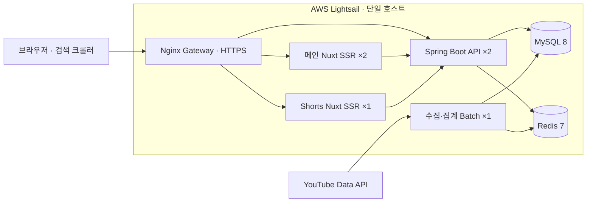
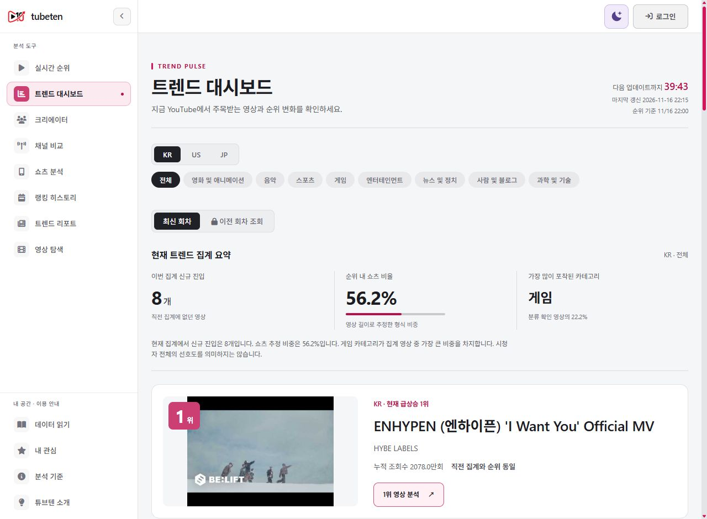
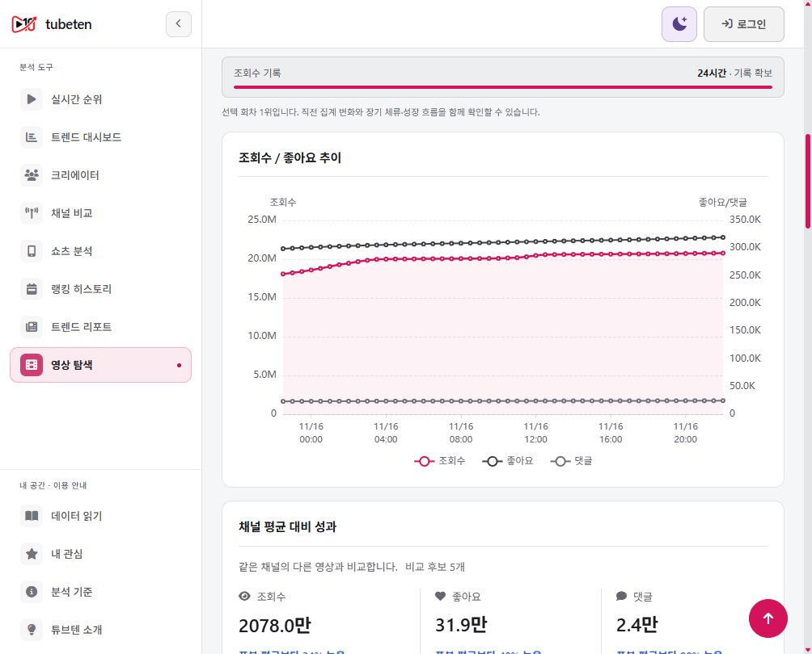
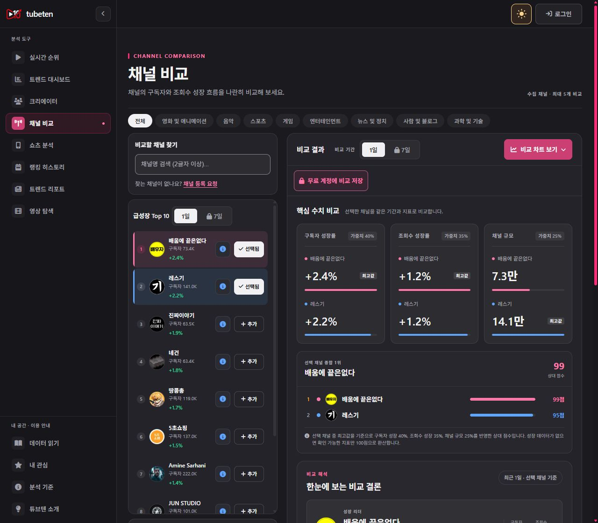
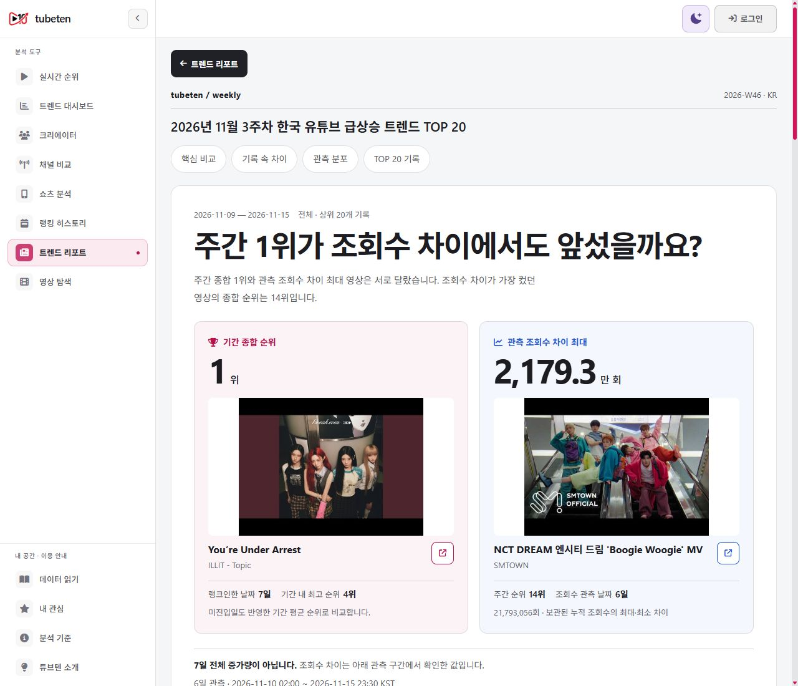
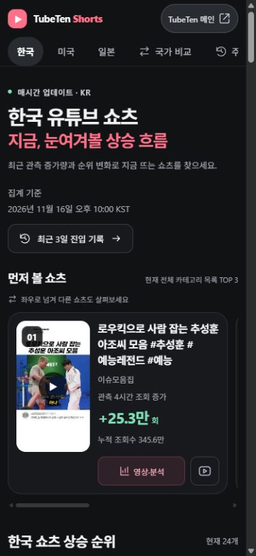
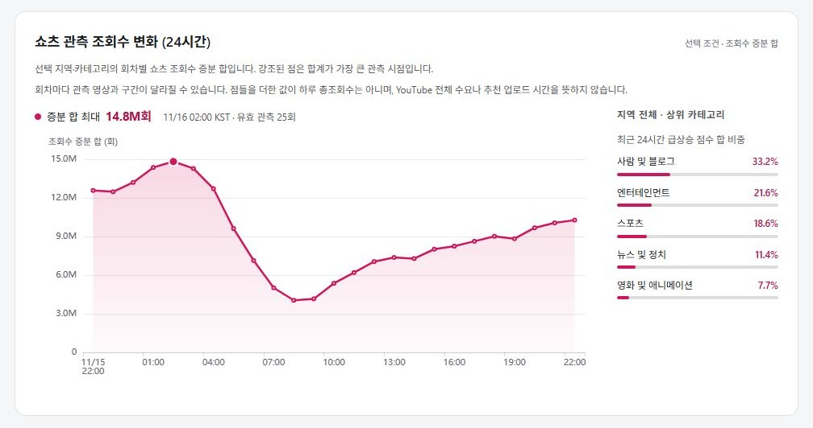
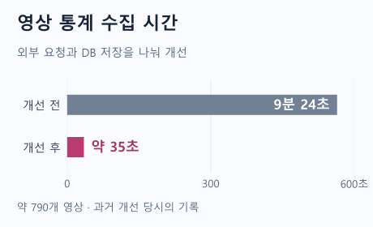

<p></p>

# TubeTen

**한국·미국·일본의 유튜브 급상승 영상과 채널을 분석하는 서비스**

| 항목 | 내용 |
| :--- | :--- |
| **기간** | **2026.01 ~ 2026.11** |
| **역할** | 1인 기획·개발·운영 |
| **범위** | 데이터 수집·집계, API, 웹 화면, AWS 배포 |

[GA4 운영 지표](#ga4-운영-지표) · [기술 스택](#기술-스택) · [AWS 운영 구조](#aws-운영-구조) · [운영 화면](#운영-화면) · [대표 설계 사례](#대표-설계-사례) · [성능 개선](#성능-개선)

## GA4 운영 지표

**집계 기간** · 2026.09.01 ~ 2026.11.14 (75일)<br>GA4의 페이지 및 화면 보고서에서 운영 호스트를 각각 필터링했습니다.

| 운영 사이트 | 페이지 조회수 | 활성 사용자 | 최다 조회 화면 |
| :--- | ---: | ---: | :--- |
| **TubeTen 메인** | **20,911회** | **3,435명** | 한국 실시간 순위 · 6,054회 |
| **TubeTen Shorts** | **4,025회** | **1,082명** | 한국 Shorts 순위 · 2,741회 |

**한국 순위 화면이 Shorts 전체 조회의 68.1%를 차지했습니다.**

페이지 조회수에는 반복 열람을 포함합니다. 활성 사용자는 호스트별 집계이며, 같은 사람이 두 호스트에 포함될 수 있습니다. [GA4 페이지 및 화면 지표](https://support.google.com/analytics/answer/12926732?hl=ko)

## 기술 스택

| 영역 | 사용 기술과 적용 범위 |
| :--- | :--- |
| **백엔드** | **Java 21 · Spring Boot 3.5** · JPA · JdbcTemplate · Resilience4j<br>수집·집계와 공개 API 분리, 대량 쓰기·조회, 외부 호출 실패 처리 |
| **화면** | **Nuxt 3 · Vue 3** · TypeScript · JavaScript · Pinia · ECharts<br>메인·Shorts 화면의 SSR, 필터 상태 관리, 관측 시계열 표시 |
| **데이터** | **MySQL 8 · Redis 7** · YouTube Data API<br>공개 통계 수집, 시점별 스냅샷·주간 기록 저장, 반복 조회 캐시 |
| **배포** | **AWS Lightsail · Docker Compose** · Nginx · GitHub Actions · GHCR<br>단일 서버 네트워크 구성, SHA로 버전을 식별하는 이미지 게시·배포 |
| **인증** | **Firebase Authentication · Spring Security**<br>회원 로그인과 API 접근 제어 |
| **검증** | **JUnit 5 · Testcontainers · Playwright** · ArchUnit · OpenAPI<br>계층 의존성, 공개 API 계약, DB·캐시와 브라우저 흐름 검증 |

## AWS 운영 구조

**AWS Lightsail 단일 인스턴스**에서 Ubuntu와 Docker Compose로 운영했습니다. 서버와 네트워크를 한곳에서 관리하는 데 적합한 구성이었습니다. **2 vCPU · 8GB RAM · 160GB SSD** 안에서 조회, 수집, 저장에 쓰는 자원을 관리했습니다.

메인과 Shorts 도메인은 같은 Nginx Gateway로 연결했습니다. 데이터는 **30분마다 관측**하고, 공개 순위는 **매시간 발행**했습니다.



| 운영 과제 | 구현과 선택 |
| :--- | :--- |
| **공개 접속** | Nginx가 메인·Shorts의 HTTPS 요청을 받고 화면과 API로 라우팅했습니다. MySQL·Redis·애플리케이션 포트는 Compose 내부 네트워크에 두었습니다. |
| **순차 배포** | API와 메인 Web은 각각 두 컨테이너로 운영했습니다. 한 대씩 교체하며 새 이미지 SHA와 상태 검사 결과를 확인했습니다. 이중화의 범위는 컨테이너 교체와 프로세스 장애입니다. 두 컨테이너가 같은 호스트와 DB를 공유하므로 호스트와 DB는 단일 장애점입니다. |
| **장애 대응** | 수집·집계 작업은 별도 프로세스로 실행하고, 외부 API 요청과 DB 저장의 동시성은 각각 제한했습니다. Redis 조회가 실패하면 공개 조회는 DB를 사용합니다. |
| **데이터 복구** | MySQL 논리 백업과 복원 검증을 운영 절차로 정리했습니다. Redis 조회 캐시는 DB를 바탕으로 재생성합니다. 앱 이미지 교체와 DB 스키마 변경은 별도 작업으로 다뤘습니다. |

### 검증한 변경을 운영에 반영하는 흐름

```text
GitHub Actions 품질 검사
  → 통과한 커밋 SHA를 체크아웃해 API·Web·Shorts·Batch 이미지 빌드
  → GHCR에 커밋 SHA 태그로 게시
  → Lightsail에서 버전을 지정해 이미지 pull 및 대상 컨테이너 순차 교체
  → 실행 이미지 SHA·상태 검사·외부 응답·최신 집계 시각 확인
```

**복구 기준** · 애플리케이션을 되돌릴 때 이전 이미지 SHA를 지정할 수 있게 했습니다. 스키마 변경이 포함된 버전은 이미지 교체에 앞서 호환성과 백업 복원 여부를 확인하는 절차를 마련했습니다.

## 운영 화면

*2026.11.16 운영 환경 캡처 · 이미지를 열면 원본 크기로 볼 수 있습니다.*

### 트렌드 대시보드

[](./assets/screenshots/dashboard.jpg)

지역·카테고리별로 회차를 조회하고, 신규 진입 수와 쇼츠 비중, 상위 영상으로 이어집니다.

### 영상과 채널 분석

| 영상 상세 분석 | 채널 비교 |
| :--- | :--- |
| [](./assets/screenshots/video-analytics.jpg) | [](./assets/screenshots/channel-comparison.jpg) |
| 순위 기준 시각에서 영상의 시계열과 관측 근거로 이동합니다. 조회 기간과 실제로 확보한 관측 범위를 함께 표시했습니다. | 최대 5개 채널을 같은 비교 기간으로 놓고 성장률과 규모를 살펴봅니다. 분석에 쓰인 지표와 상대 점수 계산 기준을 결과에 표시했습니다. |

### 주간 리포트

종합 순위에는 미진입일과 진입일 순위가 함께 반영됩니다. 조회수 차이는 관측된 누적 조회수의 최대값과 최소값을 비교합니다. 캡처한 46주차에는 **7일 모두 순위에 든 영상이 종합 1위**였고, **관측 조회수 차이가 가장 컸던 영상은 종합 14위**였습니다. 두 카드를 나란히 두고 각각에 진입일 수와 관측 시작·종료 시각을 표시했습니다.

[](./assets/screenshots/weekly-report.jpg)

45주차 공개 요약에서는 같은 곡의 음원 영상과 뮤직비디오가 각각 주간 2위와 10위에 오른 사례를 설명했습니다. 이전 주차 전문은 회원에게 제공했습니다.

### Shorts 탐색과 분석

| 모바일 Shorts | 24시간 관측 분석 |
| :--- | :--- |
| <a href="./assets/screenshots/shorts-mobile.jpg"></a> | [](./assets/screenshots/shorts-analytics.jpg) |
| 별도 Nuxt 앱에서 국가별 상승 목록과 최근 3일 진입 기록을 탐색합니다. | 선택 범위의 회차별 조회수 증분 합을 보여주고, 관측 횟수와 최대 관측 시점을 함께 표시했습니다. |

## 데이터 수집과 순위

1. **수집** · YouTube Data API에서 후보 영상과 공개 통계를 가져옵니다. 영상 ID를 중복 제거하고 최대 50개씩 묶어 요청합니다.
2. **계산** · 최근 유효 구간과 2·4시간의 시간당 증가, 증가 흐름의 지속성, 좋아요·댓글 반응을 계산합니다. 영상 형식과 게시 후 경과가 같은 집단에서 특징의 백분위를 구하고, 표본이 작으면 전체 후보 분포를 섞어 극단값을 완화했습니다.
3. **저장과 발행** · 동일 회차의 순위와 계산 특징을 한 트랜잭션으로 저장한 뒤, 완전성을 검사한 회차를 공개했습니다. 트랜잭션 커밋 후 관련 캐시를 갱신하고, 동일한 계산 정책의 연속 회차끼리 순위 변동을 비교했습니다.
4. **화면과 검증** · 순위 산정은 최근 관측 구간을 사용합니다. 영상 상세는 선택 기간, 확보한 관측 범위, 마지막 관측 시각을 구분합니다. 데이터 누락과 측정값 0도 별도 상태로 표시했습니다.

국가 라벨은 **후보 영상의 수집 범위**를 뜻합니다. 조회수에는 원본 영상의 전체 공개 수치를 사용했습니다. Shorts 분류는 길이와 공개 메타데이터로 추정했으며, 별도 Shorts 리스트에는 목록 내 순위와 전체 영상 집계에서의 순위 변화를 각각 표시했습니다.

<details>
<summary>순위의 품질을 어떻게 평가했는가</summary>

공개 회차를 발행한 뒤 6시간·24시간의 관측값을 라벨로 만들어 비교할 수 있게 했습니다. 이후 성장한 영상이 상위에 들어오는 정도는 Recall@K·NDCG@K로, 연속 회차의 목록 변동은 Rank Churn으로 확인했습니다. 계산 정책마다 버전을 기록해 같은 기간의 결과를 비교할 수 있도록 구성했습니다.

</details>

## 대표 설계 사례

### 시간 초과 뒤에도 끝나지 않는 배치

후보 수집이 시간 초과된 뒤에도 스레드가 남아 있었고, 같은 실행 큐를 쓰는 스냅샷과 순위 계산까지 지연됐습니다. 시간 초과 시점에 곧바로 실행 소유권을 해제하면, 다음 회차에서 기존 작업과 새 작업이 겹칠 수 있었습니다.

시간 초과가 발생하면 같은 그룹의 다음 작업을 새 실행 풀로 넘겼습니다. 실행 중인 작업의 가드와 DB 소유권은 실제 종료 시점에 해제하고, 큐에서 시작을 기다리는 작업은 시작 가드에서 취소했습니다. 저장 경로에서도 영상 ID와 수집 시각을 유일 키로 두어 같은 스냅샷을 다시 받아도 기존 값을 보존했습니다.

운영 Batch는 단일 인스턴스입니다. DB 소유권에 만료 시각을 두었으며 실행 중 갱신은 구현하지 않았습니다. 다중 인스턴스로 확장할 경우에는 만료 전에 소유권을 갱신하거나 작업을 분할하는 설계가 필요합니다.

### 공개 리포트 요약과 회원 전용 본문의 응답 경계

지난 주차의 목록은 누구나 탐색할 수 있고, 전문은 회원에게 제공해야 했습니다. 목록에서는 원고가 있는 리포트만 추려 관측 근거를 한 번에 조회했습니다. 저장된 순위와 관측 구간이 원고와 일치할 때 핵심 발견과 근거를 두 필드로 반환했습니다.

상세 API는 본문을 조회하기 전에 회원 세션을 확인합니다. 비회원이 이전 주차를 직접 호출하면 `401`을 반환하며, 상세 응답에는 `Cache-Control: private, no-store`를 적용했습니다. API 테스트에서 근거가 맞지 않는 요약의 생략과 비회원·회원 응답을 검증했고, 운영에서도 공개 목록과 비회원의 상세 접근 차단을 확인했습니다.

## 성능 개선

| 병목 | 구현한 변경 | 측정 기록 |
| :--- | :--- | :--- |
| **영상 통계 수집** | 외부 요청을 묶고 응답 대기와 DB 트랜잭션을 분리했습니다. Virtual Thread를 사용하면서 외부 호출과 저장의 동시성에 각각 한도를 두었습니다. 일괄 입력으로 중복 스냅샷도 처리했습니다. | 약 **790개 영상**, 기존 **9분 24초 → 약 35초** |
| **시계열·히트맵 조회** | 회차와 후보 범위를 먼저 좁히고, 기본 목록과 상세 계산을 분리했습니다. 반복 집계는 Redis에서 재사용하고 긴 기간은 완료된 일별 집계로 조회했습니다. | 과거 약 **44만 행** 환경에서 시계열 **약 51ms**, 히트맵 **약 47ms** |
| **홈 차트 다운로드** | 상세 링크의 화면 진입만으로 요청되던 차트 청크를 포인터 접근·키보드 초점 시점에 미리 받도록 변경했습니다. | 홈 유휴 구간에서 Brotli 기준 차트 청크 **약 122KiB**의 자동 요청을 제거 |



*수집·조회 수치는 당시 환경의 기록입니다. 조회 측정에는 개선 전 비교값이 없으며 운영 API의 p95와 구분합니다. 차트 청크 수치는 2026년 10월 로컬 브라우저에서 사용자 조작 전 네트워크 요청을 대조한 결과입니다.*

## 검증과 운영

- **비동기 응답과 필터** · 국가·카테고리를 연속으로 바꿀 때 늦은 응답이 최신 조건을 덮어쓰지 않도록 요청 소유권을 검사했습니다. SSR에서는 첫 본문을 제공하고 차트는 필요한 시점에 로드하며, 이미지·그래프가 들어갈 공간을 확보했습니다.
- **브라우저 회귀의 실제 사례** · 태블릿 CI에서 최근 진입 기록 링크를 눌러도 대상이 화면 밖에 남았습니다. 요청 추적에서 이동 도중 순위 목록이 추가되어 도착 지점이 밀린 것을 확인했습니다. 기록 영역을 페이지가 추가되는 목록 앞으로 옮기고, 링크를 눌러도 다음 순위 페이지 요청이 발생하지 않는 조건을 추가했습니다.
- **배포 검증** · JUnit·ArchUnit으로 계산, 트랜잭션 경계, 모듈 의존을 확인했습니다. Testcontainers로 MySQL·Redis를 검증하고 Playwright로 메인과 Shorts의 SSR·탐색 흐름을 확인했습니다. 11월 16일 배포에서는 메인 브라우저 스모크 **235건**이 통과했고, 운영에서 주간 리포트 공개 요약과 회원 전용 전문의 접근 제어를 확인했습니다.

<details>
<summary>2026년 11월 16일 프런트 성능 예산</summary>

| 페이지 | 초기 JS | 예산 |
| :--- | ---: | ---: |
| 홈 | 84.8 KB | 85 KB |
| 실시간 순위 | 104.0 KB | 110 KB |
| Shorts 분석 | 103.2 KB | 110 KB |

Node.js 24.22.1의 로컬 프로덕션 빌드에서 경로별 초기 JavaScript의 Brotli 압축 크기를 합산했습니다. HTML·이미지·외부 스크립트·후속 다운로드는 집계 범위 밖입니다.

</details>

---

운영 화면·설계 기록 기준 **2026년 11월 16일** · 운영 도메인 `www.tubeten.co.kr`, `shorts.tubeten.co.kr`

캡처에 포함된 영상 썸네일의 권리는 각 권리자에게 있습니다.
