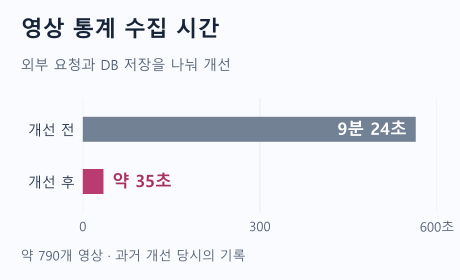
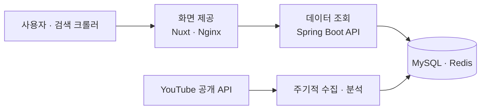
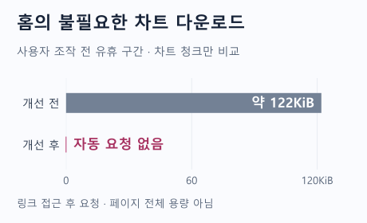

  

<h1 align="center">TubeTen</h1>

  <strong>지금 성장하는 YouTube 콘텐츠를 발견하는 서비스</strong> 
  한국·미국·일본의 영상과 Shorts, 크리에이터의 변화 흐름을 살펴봅니다.

  <a href="https://www.tubeten.co.kr"><strong>서비스 보기</strong></a>
  &nbsp;·&nbsp;
  <a href="https://shorts.tubeten.co.kr"><strong>Shorts 보기</strong></a>
  &nbsp;·&nbsp;
  <a href="https://www.tubeten.co.kr/api/swagger-ui.html"><strong>공개 API</strong></a>

**목차**

[01 서비스 소개](#01-서비스-소개) · [02 담당 역할](#02-담당-역할) · [03 주요 성과](#03-주요-성과) · [04 기술 스택](#04-기술-스택)

[05 시스템 구조](#05-시스템-구조) · [06 대표 문제 해결](#06-대표-문제-해결) · [07 화면 경험과 검증](#07-화면-경험과-검증) · [08 운영 경험과 확장 기준](#08-운영-경험과-확장-기준)

---

## `01` 서비스 소개

누적 조회수만으로는 최근 빠르게 성장하는 콘텐츠를 찾기 어렵습니다. TubeTen은 영상의 조회수·좋아요·댓글 변화를 주기적으로 관측해, 사용자가 **지금 주목받는 영상과 성장하는 채널을 찾아볼 수 있도록** 만든 서비스입니다.

- **콘텐츠 발견:** 국가·카테고리별 순위와 Shorts에서 관심 영상을 찾습니다.
- **변화 확인:** 영상 분석과 채널 비교로 최근 성장 흐름을 살펴봅니다.
- **기록 탐색:** 주간 리포트와 순위 이력에서 지난 흐름을 확인합니다.

순위는 수집한 공개 데이터 안에서 계산한 자체 지표입니다.

---

## `02` 담당 역할

**기획부터 백엔드·프런트엔드 개발, 데이터 수집, 배포·운영까지 담당한 개인 프로젝트입니다.** 제한된 서버 자원에서 데이터 수집과 사용자 조회를 함께 운영하며, 성능·데이터 신뢰성·배포 과정을 개선했습니다.

**개발·운영 기간:** 2026.01 ~ 현재

---

## `03` 주요 성과

| 과제 | 제가 한 일 | 확인한 결과 |
|---|---|---|
| 오래 걸리는 데이터 수집 | 외부 요청과 DB 저장의 병목을 나누고 묶음 처리 | 약 790개 영상 수집 **9분 24초 → 약 35초** |
| 조건에 따라 무거워지는 조회 | 조회 범위를 좁히고 집계·캐시를 재사용 | 과거 약 44만 행에서 시계열 **약 51ms**·히트맵 **약 47ms** 기록 |
| 홈에서 필요 없는 차트 다운로드 | 링크가 보일 때의 자동 요청을 사용자 접근 시점으로 변경 | 유휴 구간의 **약 122KiB 차트 자동 요청 제거** |
| 검증 결과와 배포 버전의 연결 | 검증한 결과물을 버전별 이미지로 게시 | 배포 버전 추적과 이전 버전 복구 절차 마련 |

*수집·조회 시간은 과거 개선 당시의 기록입니다. 조회 수치는 전후 비교값이 없으며, 최신 운영 API 응답 시간이나 p95를 뜻하지 않습니다. 차트 다운로드는 로컬 브라우저 회귀 검사에서 확인한 범위입니다.*

---

## `04` 기술 스택

| 영역 | 주요 기술 |
|---|---|
| 백엔드 | Java 21 · Spring Boot 3.5 · Spring Data JPA · JdbcTemplate |
| 데이터 | MySQL 8 · Redis 7 |
| 화면 | Node.js 24.22.1 · Nuxt 3 · Vue 3 · JavaScript/TypeScript · Pinia · ECharts |
| 인프라·배포 | AWS Lightsail · Docker Compose · Nginx · GitHub Actions · GHCR |
| 검증 | JUnit 5 · Testcontainers · ArchUnit · Playwright · OpenAPI |

---

## `05` 시스템 구조

영상 통계는 30분마다 관측하고, 순위는 60분마다 발행합니다. AWS Lightsail의 2 vCPU·8GB RAM 환경에서 화면 조회와 데이터 수집을 별도 프로세스로 운영하며, 공유하는 서버와 DB의 부담을 제어하기 위해 동시 실행량을 제한했습니다.

### 주요 기술 선택과 판단

| 선택 | 선택한 이유 | 함께 관리한 제약 |
|---|---|---|
| JPA와 JDBC 병행 | 엔티티 변경은 JPA로 관리하고, 대량 저장·집계는 JDBC로 실행 SQL을 제어 | 두 저장 경로의 트랜잭션과 데이터 규칙 일치 |
| Virtual Thread와 별도 동시성 제한 | 외부 응답 대기를 처리하면서 API 요청과 DB 저장의 처리량을 각각 제한 | 스레드 수와 별개인 외부 API 할당량·DB 연결 풀 한도 |
| API·Batch 분리, 공통 모듈 공유 | 긴 수집 작업을 사용자 요청에서 분리하고 도메인·저장 규칙의 중복을 줄임 | 공유 DB·호스트의 자원 경합과 스키마 호환성 |

Redis와 사전 생성 JSON으로 반복 집계를 줄이고, 캐시 오류는 DB 조회로 이어지도록 처리했습니다. 메인과 Shorts는 같은 공개 API를 사용하는 별도 Nuxt 앱이며, 수집 일정과 실행 이력은 DB 기반 자체 배치 엔진에서 관리합니다.

---

## `06` 대표 문제 해결

### 1. 수집 시간을 줄이면서 서버 부담을 제어했습니다

**문제:** 약 790개 영상의 통계를 수집하는 데 9분 이상 걸렸습니다. 외부 응답 대기와 DB 저장이 섞여 있었고, 중복 키 예외가 발생하면 건별 저장으로 돌아가는 경로도 있었습니다.

**판단:** 외부 요청은 묶어서 처리하고, 응답을 받은 뒤 짧은 저장 트랜잭션을 시작했습니다. Virtual Thread로 대기 비용을 줄이면서 외부 요청과 DB 저장에는 각각 동시성 한도를 적용했습니다. 과거 스냅샷은 유일 키와 JDBC 일괄 저장으로 중복을 처리했습니다.

**결과:** 당시 같은 규모의 수집에서 약 35초를 관측했습니다. 처리량 조정의 기준은 스레드 수보다 API 호출 수·할당량, DB 연결 대기와 다음 수집 회차의 지연으로 잡았습니다.

수집 최적화의 구현과 검증

- 영상 ID를 중복 제거하고 최대 50개씩 묶어 요청했습니다.
- 최신 메타데이터는 UPSERT, 시점별 스냅샷은 `(video_id, snapshot_at)` 유일 키와 `INSERT IGNORE`로 저장 의미를 구분했습니다.
- Resilience4j로 외부 API의 재시도·호출 차단을 구성하고, 할당량 초과·부분 실패를 정상 빈 결과와 구분했습니다.
- 과거 측정 수치를 현재 처리 성능으로 일반화하지 않습니다. 재측정 시 수집 대상 수와 캐시·외부 API 조건을 함께 기록해야 합니다.

### 2. 느린 조회를 데이터 범위와 계산 시점에서 개선했습니다

**문제:** 영상 탐색에서 목록·전체 건수·카테고리별 건수를 함께 구하며 지역 연결과 순위 이력을 넓게 계산했습니다. 오래 실행되는 조회가 DB 연결을 점유했고, 인덱스 추가가 메타데이터 잠금을 기다리며 후속 요청도 지연되는 상황을 경험했습니다.

**판단:** 선택한 지역과 영상이 등장한 회차부터 범위를 좁히고, 기본 목록에서 무거운 순위 계산을 분리했습니다. 카테고리 집계는 캐시로 재사용하고, 장기 조회는 완료된 일별 집계로 보완했습니다.

**결과와 확인 기준:** 기본 탐색과 상세 분석의 조회 비용을 분리했습니다. 목록과 건수의 조건 일치, 실행 계획과 잠금 대기를 함께 확인하며, 운영 DDL은 별도 유지보수로 다룹니다. 과거 약 44만 행 환경의 Shorts 시계열 약 51ms·히트맵 약 47ms 기록은 최신 API 전체 응답 시간과 구분합니다.

### 3. 작업 종료와 데이터 공개의 기준을 분명히 했습니다

**문제:** 제한 시간이 지나도 외부 I/O·DB 작업은 계속 실행될 수 있습니다. 이때 잠금을 먼저 해제하면 작업이 중복됩니다. 순위 계산이 끝나도 일부 데이터만 저장됐다면 사용자에게 불완전한 회차를 보여줄 수 있습니다.

**판단:** 스케줄 상태와 실제 작업 생명주기를 구분해 실행 가드를 실제 종료까지 유지했습니다. 데이터는 순위와 계산 자료를 하나의 트랜잭션으로 저장하고, 완전성을 확인한 회차만 공개했습니다. 캐시 무효화도 DB 커밋 이후에 처리합니다.

**사용자에게 보이는 결과:** 같은 계산 정책의 회차끼리 순위 변동을 비교하고, 현재 순위·과거 평균과 관측하지 못한 값·실제 0을 구분합니다. 처리 성공과 사용자에게 공개할 수 있는 상태를 별도로 관리한 사례입니다.

배치 실행과 데이터 일관성의 구현

- DB의 작업 소유권·만료 시각과 프로세스 내부 실행 가드를 함께 사용했습니다. 실행 중인 작업의 가드는 실제 종료까지 유지합니다.
- 기준 시각·처리 건수·실패 원인을 실행 이력으로 남기고 성공·부분 성공·실패를 구분합니다.
- 같은 회차의 순위와 특징을 하나의 트랜잭션으로 저장하고, 완전성과 발행 여부를 검사합니다.
- 캐시는 DB 커밋 후 무효화하고, 순위 변동은 같은 계산 정책의 회차끼리 비교합니다.
- 미래 6시간·24시간의 관측값을 기준으로 Recall·NDCG·Rank Churn을 평가합니다. 이후 성장한 영상을 얼마나 포함하고 상위에 배치했는지, 회차 간 순위가 얼마나 바뀌는지 확인합니다.
- Batch는 단일 인스턴스로 운영합니다. 다중 실행이 필요해지면 주기적인 소유권 갱신과 작업 분할을 먼저 보완해야 합니다.

### 4. 검증한 결과물을 배포와 복구의 기준으로 삼았습니다

**문제:** 서버에서 직접 빌드하던 방식은 검증한 코드와 실제 실행 결과를 연결하기 어려웠습니다. 배포에 문제가 생기면 어느 버전으로 복구할지도 명확해야 했습니다.

**판단:** GitHub Actions에서 검증한 빌드 결과를 다시 빌드하지 않고 GHCR 이미지에 담았습니다. Git commit SHA로 버전을 식별하고, API·메인 화면은 인스턴스별 상태를 확인하며 순차 교체합니다.

**결과:** 변경 버전·검증 결과·배포 이미지의 추적 경로를 연결하고 이전 이미지로 복구할 절차를 마련했습니다. DB 변경은 이미지 교체와 별도로 스키마 호환성과 복원 필요성을 판단합니다.

배포·검증 과정의 구성

- GitHub Actions의 품질 검사에서 만든 JAR·SSR 결과물을 이미지 게시 단계에서 재사용합니다.
- GHCR 이미지에 Git commit SHA를 태그로 사용합니다. 운영 서버에서는 소스를 빌드하지 않습니다.
- 운영 배포는 관리자가 실행하며, API·메인 화면은 인스턴스별 상태를 확인한 뒤 다음 인스턴스로 진행합니다.
- 일반 애플리케이션 배포와 Batch·DB 유지보수를 분리했습니다. 스키마는 버전 SQL로 적용하고 JPA `validate`로 확인합니다.
- 현재는 단일 호스트이므로 호스트·DB 장애의 복구는 인스턴스 교체와 별도로 판단합니다.

---

## `07` 화면 경험과 검증

### 첫 화면과 필터 변경을 함께 개선했습니다

초기 본문과 검색 메타데이터는 SSR로 제공하고, 무거운 차트·화면 밖 이미지는 접근 전에 준비합니다. 카드·이미지·차트의 공간을 먼저 확보해 화면 밀림을 줄였습니다.

홈에서는 상세 화면의 링크가 보이기만 해도 차트 코드가 자동 요청되는 현상을 확인했습니다. 미리 내려받는 시점을 포인터 접근·키보드 초점으로 바꿔, 조작 전 유휴 구간의 **약 122KiB 차트 자동 요청을 제거**했습니다. 390·768·1280px 회귀 검사에서 유휴 구간에는 요청하지 않고, 링크에 초점을 두면 요청하고 상세 화면으로 이동하는 동작을 확인했습니다.

이 값은 2026-10-23 로컬 확인 기록으로, 차트 청크의 다운로드 시점을 바꾼 결과입니다. 초기 JS 파일 자체의 크기나 페이지 전체 전송량이 122KiB 줄었다는 의미와는 구분합니다.

필터 변경 중 이전 응답이 늦게 도착하면 선택한 조건과 데이터가 달라질 수 있습니다. 같은 조회 요청은 공유하고, 데이터·오류·로딩 상태를 바꾸기 전에 요청 소유권을 확인하도록 했습니다. 재조회 중 기존 데이터를 유지하는 로직도 스토어에 모아 하위 위젯의 중복 상태를 줄였습니다.

### 첫 진입에 필요한 JavaScript 크기를 관리합니다

| 화면 | 확인한 초기 JS | 빌드 검사 상한 |
|---|---:|---:|
| 홈 | **84.6KB** | 85KB |
| 실시간 순위 | **101.1KB** | 110KB |
| Shorts 분석 | **101.9KB** | 110KB |

2026-10-24 로컬 빌드 산출물의 성능 예산 검사를 다시 실행한 값입니다. 경로별 초기 스크립트 목록의 Brotli 크기 합계이며, 1KB는 1,000B입니다. HTML·이미지·외부 분석 스크립트·후속 다운로드는 포함하지 않습니다. 개선 전 비교가 없는 현재 관리값으로 제시합니다.

반복 포맷 처리의 비용과 측정 조건

목록·차트에서 날짜와 숫자를 표시할 때 `Intl` 포맷 객체를 매번 만들던 코드를 재사용하도록 바꿨습니다. 같은 입력에 대한 출력 일치를 확인한 뒤 반복 호출 비용을 비교했습니다.

| 처리 | 개선 전 | 개선 후 |
|---|---:|---:|
| 서울 기준 날짜·시간 분해 | 297.86ms | 18.02ms |
| 축약 숫자 표시 | 142.80ms | 2.52ms |

2026-10-24 동일 PC·Node.js 24.22.1의 로컬 비교입니다. 각 함수는 같은 입력으로 200회 예열한 뒤 5,000회 호출을 3회 측정하고 중앙값을 사용했습니다. 이 결과는 함수 실행 비용이며, 페이지 로딩 시간·실기기 렌더링·운영 응답 시간의 개선 폭으로 환산하지 않습니다.

### 실패하기 쉬운 경계를 기준으로 검증했습니다

| 경계 | 검증 내용 |
|---|---|
| 계산·비동기 상태 | 단위 테스트로 계산 경계, 부분 실패, 작업 상태와 응답 역전 검증 |
| 실제 DB·캐시 | Testcontainers로 MySQL·Redis의 SQL, 트랜잭션·직렬화·TTL 확인 |
| 구조·공개 API | ArchUnit으로 계층 의존, OpenAPI 검사로 관리자 API 제외 확인 |
| 사용자 화면 | Playwright·axe-core로 SSR, 탐색·필터 변경, 반응형·키보드·접근성 검증 |

관리자 API는 Spring Security·JWT로 보호하고, 공개 API 문서의 허용 범위도 별도로 검사합니다. 로컬·CI 검사와 운영 확인은 구분하며, 배포 후에는 이미지 버전·공개 응답·데이터 최신 시각을 확인합니다.

화면 성능과 보안의 세부 확인

- 해시 자산의 장기 캐시와 사전 압축을 적용하고, 초기 JS·CSS 크기를 빌드 성능 예산으로 관리합니다.
- 로컬 테스트·빌드 예산 통과와 실제 사용자의 LCP·INP·CLS 개선은 별도로 측정합니다.
- 관리자 인증은 토큰 서명·유효기간 외에 계정 활성 상태와 토큰 버전도 확인합니다. MySQL·Redis는 컨테이너 내부 네트워크에 두고 비밀 값은 환경변수로 주입합니다.
- 공개 OpenAPI의 허용 경로와 실제 서버 접근 제어를 각각 검사합니다.

---

## `08` 운영 경험과 확장 기준

성능을 개선할 때는 병목과 자원 한도를 먼저 나누고, 데이터를 보여줄 때는 관측 범위와 공개 기준을 함께 설명하려고 합니다. 기능 구현 이후의 재실행·오류 확인·배포·복구까지 책임지는 경험을 쌓았습니다.

현재는 단일 서버의 운영 복잡도를 제한하고 있습니다. 다음 확장은 실제 API 응답 분포, DB 연결 대기와 집계 지연을 확인한 뒤 결정하려고 합니다.

현재 운영 범위와 남은 확인

- 호스트·DB의 고가용성과 다중 Batch 실행은 향후 확장 과제입니다.
- 캐시된 요약의 최신성 판정과 일부 파티션 실패의 상위 실행 상태 전달은 후속 보완 항목입니다.
- 로컬 테스트와 빌드 예산 통과는 실제 사용자 LCP·INP·CLS나 운영 성능 개선의 증거와 구분합니다.
- 최근 로컬 변경의 운영 반영 여부는 배포 버전과 실제 응답으로 확인해야 합니다.

---

문서 기준: **2026-10-24** · 성능 수치는 각 항목의 측정 시점·조건을 기준으로 하며, 구현 설명과 실제 운영 반영 여부는 구분합니다.
